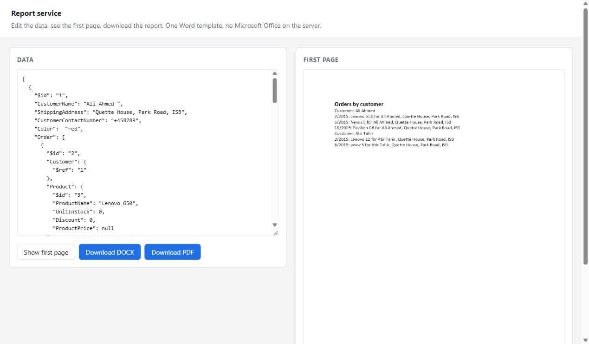

# Generate and download a report from ASP.NET Core

[](https://github.com/groupdocs-assembly/aspnet-core-report-download-net/actions/workflows/build.yml)
[](https://www.nuget.org/packages/GroupDocs.Assembly/)
[](https://dotnet.microsoft.com/)
[](LICENSE)

The request a web application actually gets is "give me this as a Word file". This sample is the
small, complete version of that: an ASP.NET Core minimal API that takes JSON, fills a Word
template and streams back a DOCX or a PDF — plus a preview of the first page, so the reader sees
the report before downloading it.

Nothing is written to disk, there is no viewer component, no front-end framework and no CDN.

```
dotnet run --project src/ReportService
```



## Read this with

| Resource | What it adds |
|---|---|
| [Blog: Generate and download reports in ASP.NET Core](https://blog.groupdocs.com/assembly/generate-and-download-reports-aspnet-core/) | why streams, and what the preview buys you |
| [Docs: Generate reports in ASP.NET Core](https://docs.groupdocs.com/assembly/net/generate-reports-in-aspnet-core/) | the reference page |
| [This repository](https://github.com/groupdocs-assembly/aspnet-core-report-download-net) | the code that runs |

## Quick start

```bash
git clone https://github.com/groupdocs-assembly/aspnet-core-report-download-net.git
cd aspnet-core-report-download-net
dotnet run --project src/ReportService
```

Open the URL it prints. Edit the data on the left, press **Show first page**, then download the
result as DOCX or PDF.

In a container:

```bash
docker build -t report-service .
docker run --rm -p 8080:8080 report-service
```

## The API

| Method | Route | Purpose |
|---|---|---|
| `GET` | `/api/sample` | the sample data the page starts from |
| `POST` | `/api/reports?format=docx\|pdf` | JSON in, the report file out |
| `POST` | `/api/reports/preview?page=1&dpi=120` | JSON in, a PNG of that page out |

```bash
curl -X POST --data-binary @data/Customers.json \
     -H "Content-Type: application/json" \
     -o customer-orders.pdf \
     "http://localhost:5090/api/reports?format=pdf"
```

## Everything in memory

A web request has no business writing intermediate files: two requests would fight over the same
name, and a container would need a writable disk for no reason. Both the template and the report
are streams:

```csharp
using MemoryStream data = new(Encoding.UTF8.GetBytes(json));
using MemoryStream report = new();
using FileStream template = File.OpenRead("templates/Customer orders.docx");

new DocumentAssembler().AssembleDocument(
    template,
    report,
    new LoadSaveOptions(FileFormat.Pdf),
    new DataSourceInfo(new JsonDataSource(data), "customers"));

return Results.File(report.ToArray(), "application/pdf", "customer-orders.pdf");
```

`Results.File` with a file name sets `Content-Disposition`, which is what makes the browser
download rather than display.

## The preview, and why it is worth the call

```csharp
PreviewOptions previewOptions = new(
    _ => page = new MemoryStream(),
    (_, _) => { /* the stream is read after GeneratePreview returns */ })
{
    PreviewFormat = PreviewFormats.PNG,
    PageNumbers = new[] { pageNumber },   // 1-based
    Resolution = resolution
};

new DocumentAssembler().GeneratePreview(source, previewOptions);
```

`GeneratePreview` arrived in 26.11. Before it, showing a report in the browser meant converting the
whole document to HTML and accepting that it would not look like the file, or embedding a viewer.
One page as a PNG is smaller than either, and it is exactly what the reader is about to download.

## Before you ship this

* **Authentication.** There is none here. Every caller is anonymous.
* **Input size.** The body is read whole into memory. Put a limit on it.
* **Errors belong to the caller.** A template or data error returns `400` with the message rather
  than a `500`: with `InlineErrorMessages` you could return the document and let the reader see
  where it broke — see
  [data-safe-templates-net](https://github.com/groupdocs-assembly/data-safe-templates-net).
* **The licence** is applied once, in the singleton's constructor. Do not apply it per request.
* **Fonts** on Linux: the [Dockerfile](Dockerfile) installs `fontconfig` and `fonts-liberation`,
  without which the preview is laid out with a substitute.

## Layout

```
src/ReportService/
  Program.cs          the three endpoints
  ReportBuilder.cs    assemble and render
  wwwroot/index.html  the page: data on the left, first page on the right
Dockerfile
templates/Customer orders.docx
data/Customers.json
```

Every GroupDocs.Assembly call mirrors an example of the product's examples repository
([GroupDocs.Assembly-for-.NET](https://github.com/groupdocs-assembly/GroupDocs.Assembly-for-.NET)).

## Related samples

* [document-generation-docker-net](https://github.com/groupdocs-assembly/document-generation-docker-net) — the same rendering on Linux, and the font setup
* [word-report-from-template-net](https://github.com/groupdocs-assembly/word-report-from-template-net) — the basics, if you are new to the library
* [GroupDocs.Assembly-for-.NET](https://github.com/groupdocs-assembly/GroupDocs.Assembly-for-.NET) — the full example set

## License

MIT, see [LICENSE](LICENSE). GroupDocs.Assembly itself is a commercial library with its own
[licence terms](https://purchase.groupdocs.com/policies/).
